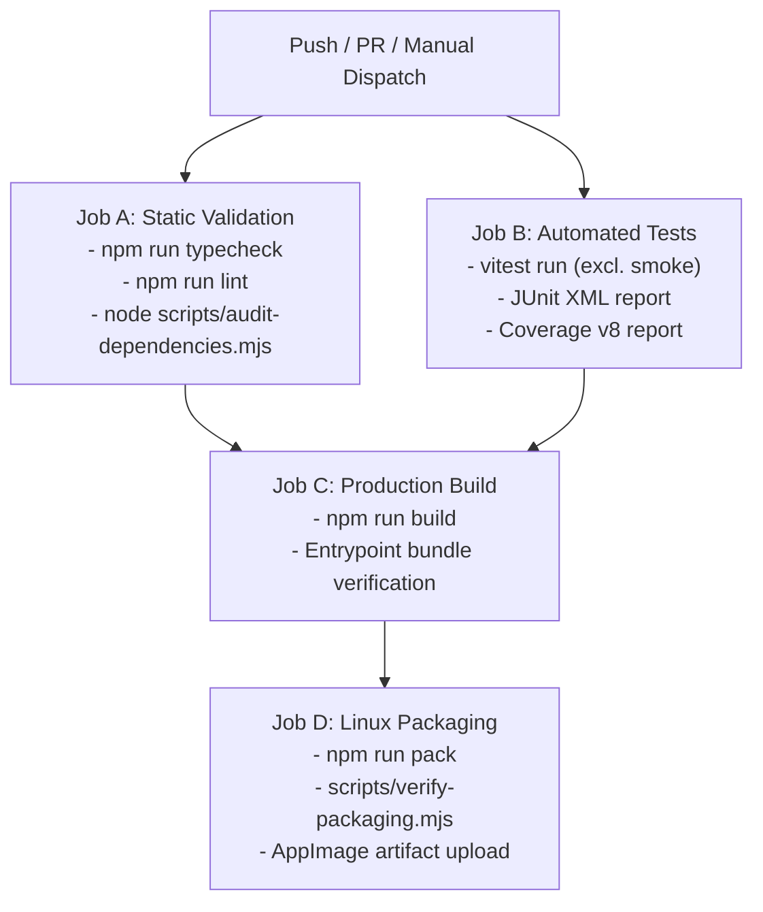

# CI Pipeline, Security Regression & Quality Gates

This document defines the automated Continuous Integration (CI) pipeline, regression testing standards, and merge quality gates for **Knot**.

---

## 1. Overview & Principles

Knot coordinates local Electron runtime services, SQLite persistence, filesystem communication bridges, and local agent processes (`agy` Antigravity CLI and Desktop Commander MCP).

To ensure every commit and pull request remains stable, predictable, and hardened against security regressions, all changes must pass an automated quality gate before merging.

### Core Principles
1. **Deterministic & Headless:** Standard CI runs in clean, isolated GitHub Actions environments (`ubuntu-latest`) without requiring live external network services, API keys, or private credentials.
2. **Clear Separation of Environments:** Real developer-machine dependencies (host `agy` binary, running MCP servers, interactive user dialogs) are strictly isolated into dedicated smoke scripts (`scripts/verify-real-integration.sh`) and excluded from CI runs.
3. **Fail-Closed Security Gates:** Dependency vulnerabilities, path traversal attempts, unauthorized IPC calls, and cross-project leaks immediately fail the pipeline.

---

## 2. GitHub Actions CI Pipeline Architecture

The workflow is defined in [`.github/workflows/ci.yml`](file:///home/roonakyadav/Projects/knot/.github/workflows/ci.yml) and executes on:
- Pull requests targeting `main`.
- Pushes to `main`.
- Pushes to `feat/threadline-branding-desktop-commander-manager` and `feat/**` branches.
- Manual execution via `workflow_dispatch`.



### Required CI Jobs

| Job | Name | Tooling / Script | Key Verifications |
|---|---|---|---|
| **Job A** | `static-validation` | `tsc --noEmit`<br>`eslint src`<br>`scripts/audit-dependencies.mjs` | Full TypeScript type checking, ESLint static analysis, and zero unhandled dependency vulnerabilities. |
| **Job B** | `test-suite` | `vitest run`<br>`@vitest/coverage-v8` | Unit and security regression suite across all 27 test files (281 tests). Exports JUnit XML and coverage reports. |
| **Job C** | `production-build` | `vite build` | Production Vite bundles for renderer (`dist/renderer/index.html`), main process (`dist/main/index.js`), and preload (`dist/preload/index.js`). |
| **Job D** | `linux-packaging` | `electron-builder`<br>`scripts/verify-packaging.mjs` | Builds Linux AppImage and directory; verifies binary execution permissions, `app.asar`, and scans for credential leaks. |

---

## 3. Dependency Security Auditing

Automated dependency auditing is executed by [`scripts/audit-dependencies.mjs`](file:///home/roonakyadav/Projects/knot/scripts/audit-dependencies.mjs).

### Audit Policies
1. **Production Dependencies:** **Zero-tolerance policy.** Any vulnerability reported in production dependencies (`package.json` `dependencies`) immediately fails the build. No exceptions are permitted.
2. **Build / Dev Tooling Dependencies:** Any dev dependency vulnerability will fail the build unless it has been explicitly reviewed, documented, and registered with a justification, tooling context, and expiration date in `DOCUMENTED_AUDIT_EXCEPTIONS`.

### Active Documented Exception
- **Advisory:** `GHSA-g3hv-75wg-m249` (`minimatch` Denial of Service via glob amplification)
- **Affected Path:** `electron-builder > app-builder-lib > minimatch` and `electron-builder > @electron/universal > minimatch`
- **Scope:** `devDependency` (Build / packaging tooling only; never bundled into the runtime application bundle `dist/` or `app.asar`).
- **Remediation Blocker:** Upstream fix in `electron-builder` requires downgrading to v25 which breaks Electron 45 compatibility.
- **Review Expiration:** `2027-05-30`

---

## 4. Packaging Verification Gate

Packaging verification is automated by [`scripts/verify-packaging.mjs`](file:///home/roonakyadav/Projects/knot/scripts/verify-packaging.mjs). It validates the build output after `npm run pack`:
1. **AppImage Artifact:** Verifies that `release/Knot-1.0.0.AppImage` exists and has non-zero size (> 10 MB).
2. **Unpacked Binary:** Verifies that `release/linux-unpacked/knot` exists, is an executable binary, and possesses POSIX `+x` permissions.
3. **Application Archive:** Verifies that `release/linux-unpacked/resources/app.asar` exists and contains the packaged application (> 1 MB).
4. **Secret Leak Detection:** Recursively inspects the unpacked distribution directory to guarantee no `.env`, `*.pem`, `*.key`, `id_rsa`, or credential files are packaged.

---

## 5. Running Quality Gates Locally

Before opening a pull request or pushing changes, run each gate locally:

```bash
# 1. Typecheck
npm run typecheck

# 2. Linting
npm run lint

# 3. Dependency Security Audit
node scripts/audit-dependencies.mjs

# 4. Automated Tests (Fast)
npm test

# 5. Automated Tests with Coverage & JUnit XML
npm run test:coverage
npm run test:ci

# 6. Production Bundle Build
npm run build

# 7. Linux Packaging & Artifact Verification
npm run package:dir
node scripts/verify-packaging.mjs
```

---

## 6. Real Developer-Machine Integration Testing

Real local machine integration tests verify integrations that require a live developer workstation environment:
- Real Google Antigravity CLI binary (`agy`) in PATH.
- Real Git repository configurations.
- Live bridge communication.

To execute the local integration suite:
```bash
./scripts/verify-real-integration.sh
```

This script:
1. Verifies local Node.js and Git toolchains.
2. Detects whether `agy` is installed and reports its version (`agy --version`).
3. Executes `tests/antigravity.smoke.test.ts` against the live binary (skipping cleanly if uninstalled).
4. Runs full bundle build and packaging checks.

---

## 7. Troubleshooting & Remediation Playbook

### When Typecheck Fails (`npm run typecheck`)
- Inspect the output compiler diagnostics for mismatched types between `src/shared/types.ts` and the main/renderer code.
- Avoid using `any` casts; ensure interface definitions are strictly maintained across the preload boundary.

### When Lint Fails (`npm run lint`)
- Run `npx eslint src --fix` to address mechanical stylistic issues.
- Fix unused imports and undeclared variables.

### When Tests Fail (`npm test`)
- Run the failing test in isolation:
  ```bash
  npx vitest run tests/<failingTest>.test.ts
  ```
- Ensure database instances use unique temporary paths or `:memory:` with proper `afterEach` teardown.

### When Dependency Audit Fails (`node scripts/audit-dependencies.mjs`)
- If the vulnerability is in a **production** dependency: Run `npm update <pkg>` or replace the library immediately.
- If the vulnerability is in a **dev** dependency:
  - Attempt `npm update <pkg>`.
  - If blocked by upstream tooling, conduct a security review to confirm it does not affect the production runtime, then document an exception in `scripts/audit-dependencies.mjs` with an expiration date.

### When Packaging Fails (`node scripts/verify-packaging.mjs`)
- Check `electron-builder.json` to verify that `files` only includes `dist/**/*` and `package.json`.
- Ensure no secret files (`.env`, `.pem`) were placed inside `dist/`.

---

## 8. GitHub Branch Protection Status & Recommended Rules

### Current Status Audit (Observed via GitHub API)
- **Target Branch (`main`):** Not yet created on remote (`HTTP 404: Branch not found`).
- **Feature Branch (`feat/threadline-branding-desktop-commander-manager`):** Exists as default remote branch, but **branch protection is not currently active** (`HTTP 404: Branch not protected`).

### Recommended Branch Protection Rules for Knot
When enabling branch protection in GitHub repository settings (`Settings > Branches > Add branch protection rule` for `main` and release branches):

1. **Require a pull request before merging:**
   - Require at least 1 approving review.
   - Dismiss stale pull request approvals when new commits are pushed.
2. **Require status checks to pass before merging:**
   - Require branches to be up to date before merging.
   - Enforce the following 4 required checks matching CI job names:
     - `Static Validation (Typecheck, Lint & Security Audit)`
     - `Automated Unit & Security Regression Tests`
     - `Production Bundle Build & Asset Verification`
     - `Linux AppImage Packaging & Integrity Gate`
3. **Require linear history:**
   - Enforce squash or rebase merges to maintain a clean git log.
4. **Do not allow bypassing the above settings:**
   - Enforce protections for repository administrators as well.

---

## 9. Definition of Done (DoD) for Pull Requests

A pull request is considered **Done** and eligible for merge only when:
- [ ] TypeScript compiles cleanly with zero errors (`npm run typecheck`).
- [ ] ESLint passes with zero warnings or errors (`npm run lint`).
- [ ] All 27 automated test files and 281+ tests pass cleanly (`npm test`).
- [ ] Dependency security audit passes with zero unreviewed vulnerabilities (`node scripts/audit-dependencies.mjs`).
- [ ] Production build succeeds and all entrypoint bundles are verified (`npm run build`).
- [ ] Linux packaging succeeds and passes integrity and leak verification (`node scripts/verify-packaging.mjs`).
- [ ] Any new feature, security control, or bug fix is accompanied by regression tests.
- [ ] Documentation (`README.md`, threat model, reliability guides) is kept in sync with code changes.
