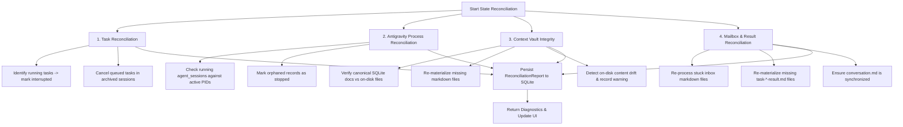

# Knot — Runtime Reliability, State Reconciliation & Recovery Architecture

## 1. Overview & Objective

Knot coordinates multi-agent software engineering by bridging a browser-based **ChatGPT** orchestrator (connected via Desktop Commander Remote MCP) with the local **Google Antigravity CLI** executor and the developer's filesystem.

Because Knot coordinates asynchronous processes, cross-agent filesystem mailboxes, and persistent SQLite storage, unexpected terminations (power loss, OS signals, SIGINT, renderer crashes) or filesystem delays could potentially cause:
- Lost or un-ingested task assignments.
- In-flight tasks trapped in indeterminate states.
- Duplicate or accidental re-execution of unconfirmed tasks.
- Desynchronization between canonical SQLite records and materialized on-disk files.
- Hanging background child processes upon application quit.

**Prompt 12/16 establishes formal reliability engineering across Knot**:
- Tasks are never silently lost or executed twice.
- State transitions are strictly validated and illegal transitions rejected.
- At-most-once task execution is guaranteed via atomic compare-and-swap (CAS) database claiming.
- State reconciliation runs automatically on startup and on-demand to recover interrupted tasks, re-materialize missing artifacts, and detect on-disk drift without mutating canonical SQLite state.
- Antigravity processes have bounded termination lifecycles.
- A dedicated **Reliability Diagnostics** interface allows developers to inspect system health and trigger manual reconciliation.

---

## 2. Identified Failure Modes & Architectural Mitigations

| Failure Mode | Root Cause | Architectural Mitigation in Knot |
|---|---|---|
| **In-Flight Task Loss on Crash** | Knot killed while Antigravity was running a task; status remains `running` in DB indefinitely. | **Startup Reconciliation**: Detects all `running` tasks on boot, marks them `interrupted`, records audit event `task_interrupted`, preserves approval status, and requires explicit user retry. |
| **Duplicate Task Execution** | Multiple workers or rapid UI triggers attempt to dispatch the same queued task concurrently. | **Atomic CAS Queue Claim**: `claimNextExecutable` executes an atomic SQL CAS (`UPDATE ... WHERE status = 'queued' AND approval_status = 'approved'`). Exactly one worker can claim the task. |
| **Silent Event Insertion Failure** | Rapid concurrent events or replay attempts trigger SQLite `UNIQUE(id)` constraint violations. | **Race-Safe Event Persistence**: `INSERT INTO events ... ON CONFLICT(id) DO NOTHING`. If conflict occurs, the existing event is returned gracefully without throwing. |
| **Materialized Markdown Loss** | External tool or developer deletes `projects/<id>/context/<docId>.md` or `task-<id>-result.md`. | **Automatic File Re-Materialization**: Reconciliation detects missing filesystem artifacts and regenerates them from canonical SQLite state. |
| **On-Disk Context Drift** | Developer or external script edits a context markdown file directly on disk outside Knot. | **Drift Detection & SQLite Primacy**: Reconciliation computes SHA-256 content hashes, detects drift, flags a conflict in diagnostics, and strictly preserves SQLite as the canonical authority without overwriting. |
| **Unprocessed Inbox Messages** | Network hiccups or file lock delays leave `.md` files sitting in ChatGPT inbox. | **Inbox Mailbox Scans**: Reconciliation scans all active inbox directories and processes any un-ingested messages into `processed/` or `rejected/`. |
| **Orphaned Antigravity Processes** | CLI process hangs on termination or does not respond to standard input closing. | **Bounded Timeout Cleanup**: Antigravity manager executes a graceful `stdin.end()` and `SIGTERM`, with a 3000ms bounded timeout race before issuing `SIGKILL`. |
| **Symlink or Malicious Inbox Message** | Local attacker or rogue script writes symlink or oversized file (>256 KB) into inbox. | **Inbox Security Boundary**: `fs.lstat` validates file type and size prior to memory allocation; symlinks are rejected and unlinked; errors are categorized (`SYMLINK_NOT_ALLOWED`, `MESSAGE_TOO_LARGE`). |
| **Instruction Tampering After Approval** | Task instructions modified after human approval was granted. | **Cryptographic Hash Invalidation**: Inbound update recalculates SHA-256 content hash, invalidates `approvedContentHash`, and reverts `status` to `awaiting_approval`. At execution time, `TaskDispatcher` halts if hashes mismatch. |
| **Untrusted Origin / Cross-Project IPC** | Compromised renderer frame attempts privileged operation. | **IPC Sender Validation**: `validateIpcSender` verifies sender frame origin against trusted local dev server or app bundle before dispatching handler. |

---

## 3. Explicit State Models & Legal Transitions

### 3.1 Task Lifecycle State Matrix

Knot enforces legal state transitions at the repository and orchestrator layers (`src/shared/taskStateModel.ts`):

```typescript
export const LEGAL_TASK_TRANSITIONS: Record<TaskStatus, TaskStatus[]> = {
  queued: ['running', 'awaiting_approval', 'cancelled', 'failed', 'interrupted'],
  awaiting_approval: ['approved', 'queued', 'cancelled', 'failed'],
  approved: ['queued', 'running', 'cancelled', 'failed'],
  running: ['succeeded', 'failed', 'cancelled', 'interrupted'],
  succeeded: [], // Terminal state
  failed: ['queued', 'awaiting_approval'], // Explicit retry only
  cancelled: ['queued', 'awaiting_approval'], // Explicit retry only
  interrupted: ['queued', 'awaiting_approval'], // Explicit retry only
  needs_attention: ['queued', 'awaiting_approval', 'cancelled'],
};
```

#### Transition Invariants:
1. **Approval Gate Enforcement**: A task in `awaiting_approval` cannot transition to `running` directly; it must be approved first.
2. **Terminal Preservation**: A task in `succeeded` cannot transition back to `running`.
3. **Explicit Retries & Content Integrity**: Failed, cancelled, or interrupted tasks cannot be automatically executed; they require an explicit user retry which returns them to `queued` (or `awaiting_approval` if instructions were materially altered after approval).
4. **Instruction Edit Invalidation**: Editing the title, description, or criteria of an approved task invalidates prior approval, transitioning it back to `awaiting_approval`.
5. **Preflight Failure Safety**: A `queued` task that fails preflight validation (missing repo, inaccessible path, security escape) transitions directly to `failed`.

### 3.2 Bridge Lifecycle Model

The filesystem bridge watcher tracks its operational state (`BridgeLifecycleState`):
- `not_initialized`: Bridge instantiated before initialization.
- `initializing`: Setting up bridge root, directories, and session index.
- `watching`: Active `chokidar` watchers watching registered session inboxes.
- `degraded`: Filesystem watcher reported an error (`EMFILE`, permission issue) but service is still running.
- `stopped`: Watchers closed cleanly on application shutdown.
- `failed`: Bridge encountered a fatal initialization error.

---

## 4. Atomic Queue Claims & At-Most-Once Execution

To guarantee that no task is ever dispatched or executed twice, `TaskRepository.claimNextExecutable(sessionId)` utilizes atomic compare-and-swap:

```sql
UPDATE tasks
SET status = 'running',
    dispatched_at = ?,
    updated_at = ?
WHERE id = (
  SELECT id FROM tasks
  WHERE session_id = ?
    AND status = 'queued'
    AND approval_status = 'approved'
  ORDER BY
    CASE priority
      WHEN 'urgent' THEN 1
      WHEN 'high' THEN 2
      WHEN 'normal' THEN 3
      WHEN 'low' THEN 4
      ELSE 5
    END ASC,
    created_at ASC
  LIMIT 1
)
AND status = 'queued'
AND approval_status = 'approved';
```

If multiple asynchronous workers or dispatch ticks attempt to claim the next task simultaneously, SQLite's transactional atomicity guarantees that only one worker transitions the row; all other workers receive 0 affected rows and return `null`.

---

## 5. State Reconciliation Mechanics

The `ReconciliationService` (`src/main/reliability/reconciliationService.ts`) runs on startup and can be triggered on demand by the developer.



### 5.1 In-Flight Task Interruption & Non-Automatic Retry
Knot strictly avoids automatically re-running tasks that were interrupted by a crash:
- The task may have already performed partial file modifications or committed Git changes.
- Automatically re-running could cause corrupted state or merge conflicts.
- Knot sets status to `interrupted`, preserves `approval_status: 'approved'`, logs an audit event, and requires the developer to click **Retry** after inspecting the working tree.

### 5.2 Context Vault: Canonical SQLite Authority
- SQLite is the **sole source of truth** for project decisions, constraints, and architecture.
- If an on-disk markdown document is deleted or missing, Knot re-materializes it from SQLite.
- If an on-disk document was edited outside Knot, Knot detects the content hash mismatch, logs a drift warning in the reconciliation report, and **never silently overwrites** the database.

### 5.3 Task Result Outbox Re-Materialization
If `task-<taskId>-result.md` was accidentally removed from `outbox/knot/`, Knot reconstructs the structured result document from the task's execution telemetry and SQLite result message, ensuring ChatGPT can discover it upon resuming.

---

## 6. Bounded Termination & Graceful Shutdown

On application quit (`app.on('before-quit')`), Knot executes a disciplined, sequential shutdown:
1. **Stop Orchestrator**: Stops `TaskDispatcher` from claiming or dispatching any new tasks.
2. **Cleanup Antigravity Processes**:
   - Closes `stdin` on active CLI processes.
   - Issues `SIGTERM`.
   - Enforces a **3000ms bounded timeout race** (`Promise.race([allStopped, timeout])`).
   - If processes remain alive after 3000ms, force-kills via `SIGKILL`.
3. **Close Filesystem Bridge**: Unwatches all session inboxes and flushes pending writes.
4. **Cleanup Desktop Commander**: Stops MCP process cleanly.
5. **Close SQLite Database**: Executes clean database disconnect and flushes WAL log.

---

## 7. Reliability Diagnostics & UI Recovery

A dedicated **Reliability Modal** (`src/renderer/components/Workspace/ReliabilityModal.tsx`) is available directly from the Workspace header:
- **System Health Status**: Real-time evaluation (`healthy`, `degraded`, `failed`).
- **Database Status**: Version, connection availability, WAL mode, busy timeout.
- **Bridge Status**: Lifecycle state, active watcher count, watched directories, pending and rejected counts.
- **Task Telemetry**: Real-time counts of running, queued, awaiting approval, and interrupted tasks.
- **Latest Reconciliation Report**: Duration, inspected counts, detected issues, repaired issues, and granular issue logs.
- **Run State Reconciliation Button**: Interactive trigger to execute an immediate reconciliation pass.

---

## 8. Automated Reliability Verification & CI Quality Gates

All failure modes, recovery paths, and concurrency controls are covered by automated regression suites and enforced by CI gates:

1. **Atomic CAS Claiming Race**: Tested in `tests/reliability.test.ts` and `tests/securityRegression.test.tsx`. Simulates two simultaneous worker claims on the same queued task; verifies that exactly one succeeds and the other receives `null`.
2. **Crash & Restart In-Flight Task Recovery**: Tested in `tests/reliability.test.ts` and `tests/securityRegression.test.tsx`. Verifies that orphaned `running` tasks are reconciled to `interrupted` with `failureReason` and approval status preserved.
3. **Idempotent Event Ingestion**: Tested in `tests/securityRegression.test.tsx`. Verifies duplicate event IDs are safely deduplicated without throwing.
4. **Context Drift Detection & Re-Materialization**: Tested in `tests/reliability.test.ts`. Verifies missing context markdown documents are re-materialized from SQLite authority without overwriting newer manual edits.
5. **Bounded Process Lifecycle & SIGKILL Escalation**: Tested in `tests/desktopCommanderManager.test.ts` and `tests/antigravity.test.ts`. Validates timeout-bounded graceful termination and fallback escalation.

For instructions on running these reliability tests and quality gates locally and in CI, see [`docs/ci-and-quality-gates.md`](file:///home/roonakyadav/Projects/knot/docs/ci-and-quality-gates.md).
